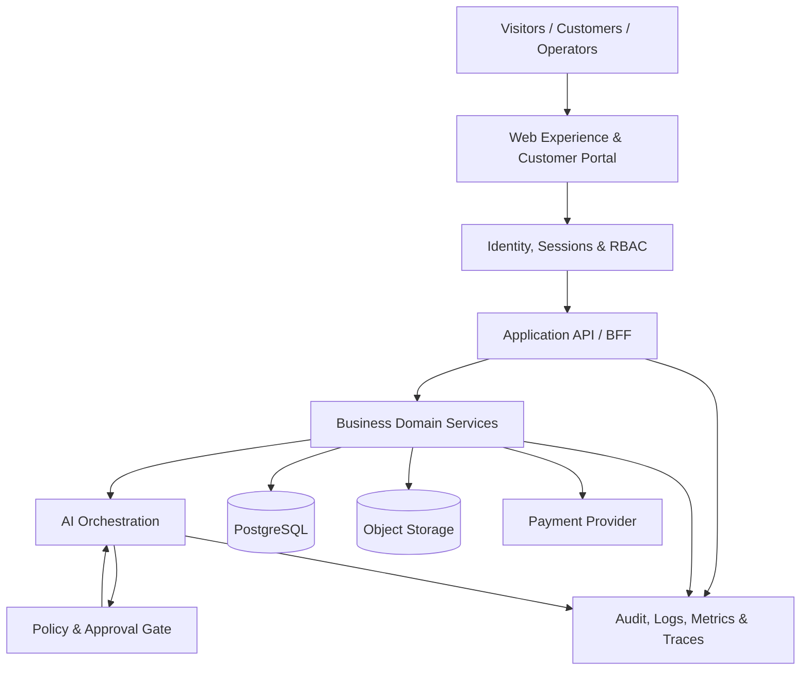

# Mowglai — Unified Platform Architecture

Status: Proposed architecture baseline  
Date: 2026-11-02  
Implementation status: Documentation only; no production code or infrastructure changed.

## 1. Product boundary

Mowglai is treated as one product ecosystem with two independently maintained codebases:

- Product experience and existing business workflows: `Div0011/mowglai`.
- Reusable AI foundation and shared engineering contracts: `1nsharma/mowglai`.

These repositories are not interchangeable and must not be merged wholesale. The product repository remains the source of truth for existing customer-facing workflows until an explicit migration is reviewed and accepted.

## 2. Target architecture

### Experience layer
- Public website, service catalogue, templates, lead capture and customer portal.
- Server-rendered pages by default; client-side code only for required interaction.
- Accessible, mobile-first design with performance budgets.
- Marketing claims and performance metrics must be evidence-backed.

### Identity and authorization
- Server-validated sessions.
- Organization and project membership with explicit roles.
- RBAC enforced at every server-side action.
- Tenant context derived from the authenticated session, never trusted from a client-supplied tenant ID.
- Database row-level security (RLS) or equivalent tenant predicates.

### Business domain
- Leads, contacts, organizations, projects, proposals, tasks, deliverables, invoices and subscriptions.
- Explicit lifecycle state machines and idempotent commands.
- Domain events carry tenant, actor, request and correlation identifiers.
- Audit records are append-only for sensitive business actions.

### AI orchestration
- Reuse the existing task-aware AI Core as a library boundary, not as an unrestricted agent runtime.
- Model selection and provider credentials remain server-side.
- Prompt versions and model identifiers are recorded for reproducibility.
- Tool calls require allowlisted tools, typed schemas, policy checks and explicit authorization.
- Retrieval sources carry provenance and access-control metadata.
- AI output is advisory until a human-approved workflow commits an external side effect.

### Payments
- Provider checkout is not proof of payment.
- Verify provider signatures server-side and reconcile webhook events.
- Use idempotency keys and immutable payment-event records.
- Derive subscription state from verified provider events, not browser redirects.
- Never expose provider secrets in client bundles, source control or logs.

### Data and storage
- PostgreSQL as the transactional source of truth.
- Object storage for uploaded assets and generated deliverables.
- Separate operational data, audit events and analytics projections.
- Tenant-scoped access and retention/deletion rules are mandatory.

### Observability
- Structured logs with request and correlation IDs.
- Metrics for latency, failures, cost, queue depth and provider usage.
- Traces across API, database, payment and AI boundaries.
- Redact credentials, personal data and sensitive prompt content from logs.

## 3. Domain model (initial)

Core entities:

- `Organization`
- `User`
- `Membership`
- `Role` / `Permission`
- `Lead`
- `Contact`
- `Project`
- `ProjectTask`
- `Proposal`
- `Deliverable`
- `Invoice`
- `PaymentAttempt`
- `Subscription`
- `AiRun`
- `AiArtifact`
- `Approval`
- `AuditEvent`

Every organization-owned entity must have a non-null tenant/organization key. Cross-tenant access must fail closed.

## 4. Repository responsibilities

| Repository | Responsibility | Migration rule |
|---|---|---|
| `Div0011/mowglai` | Existing product UI, routes, customer workflows and legacy integrations | Preserve behaviour while replacing unsafe boundaries incrementally |
| `1nsharma/mowglai` | AI Core, shared contracts, tests and architecture packages | Promote packages only after API compatibility and test validation |

Do not copy complete directories between repositories. Extract narrow modules with explicit interfaces and migration tests.

## 5. Security invariants

1. No secrets in tracked files, browser bundles, fixtures or documentation.
2. All credentials are rotated after confirmed exposure.
3. No client-side authorization decisions.
4. No user-controlled URL fetch without strict destination validation, DNS/IP checks, redirect restrictions and egress controls.
5. TLS certificate verification remains enabled.
6. CORS uses explicit trusted origins.
7. Sensitive endpoints have authentication, authorization, CSRF protection where applicable, input validation and rate limits.
8. Payments are reconciled from verified server-side events.
9. AI tools run with least privilege, explicit allowlists, timeouts and bounded resource budgets.
10. No autonomous production deployment or destructive action without an authorized approval gate.

## 6. Release strategy

- Local development → CI checks → isolated staging → security review → authorized production release.
- No production deployment from feature branches.
- Database changes use reviewed migrations and a tested rollback/forward-fix plan.
- Feature flags protect high-risk changes.
- Backups and restore tests precede schema migrations.
- Keep a release manifest with commit SHA, migrations, environment and approver.

## 7. Non-goals for the first redesign increment

- No blind rewrite of the current website.
- No forced monorepo migration.
- No autonomous agent access to production databases or payment controls.
- No public team/role attribution changes.
- No changes to live hosting, DNS, payment credentials or customer data without authorized operator access.

## 8. Acceptance criteria

- Architecture boundaries and repository ownership are documented.
- Authentication and tenant-isolation tests exist before customer portal expansion.
- Payment state is derived from verified provider events.
- URL-fetching features are protected against SSRF.
- AI actions are policy-gated, auditable and human-approved for external side effects.
- CI validates lint, typecheck, unit tests, dependency audit and build.
- Staging smoke tests pass before production approval.
